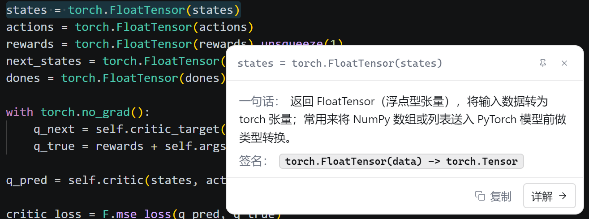
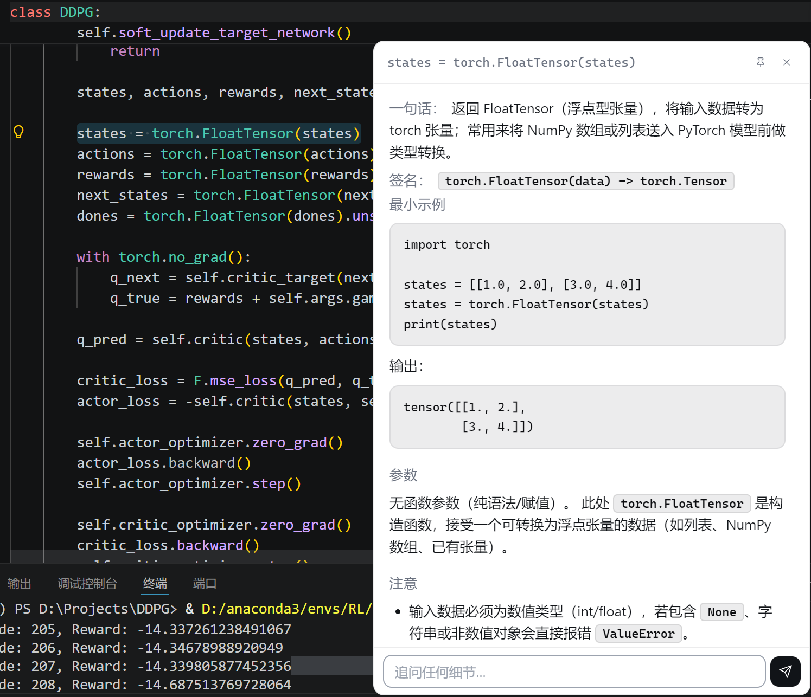
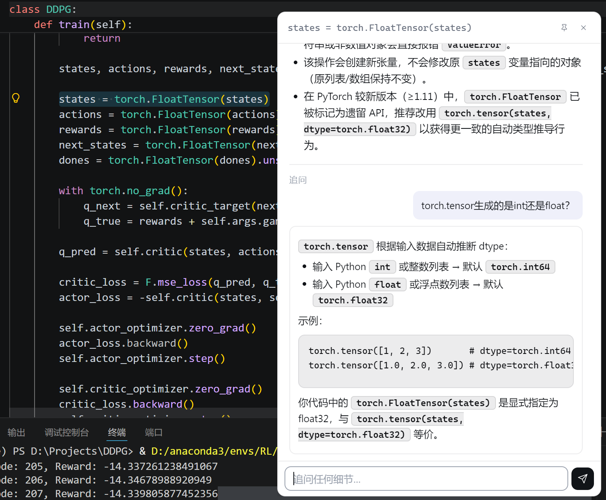

# 汤师爷 · TangShiYe

> 鼠标选中代码，双击 `Ctrl`，逐行讲人话。
> 常驻系统托盘的桌面代码阅读器 —— **不联网就能用**。如果连上免费的云端模型或者跑本地 Ollama，还能实现AI写代码和对话。


---

## 它解决什么问题

名字取自《让子弹飞》 —— 汤师爷，您给翻译翻译，什么叫惊喜。
读别人写的代码时，最耗神的从来不是语法，而是“这一行到底想干嘛”。切窗口去问 AI，要把代码复制来复制去，上下文还断。
汤师爷把这件事压成三个动作：**选中 → `Ctrl+C` → 双击 `Ctrl`**，鼠标旁边直接弹中文解读。
完全不联网、不需要 API Key、不需要本地模型，安装之后就可以用。
如果你有云端大模型的api-key，可以使用联网模式，汤师爷就化身为AI助手，不仅能解释代码的含义，还能追问，甚至直接帮你写代码。
如果你在本地部署了大模型，汤师爷同样也能够变成AI助手进行对话。
三种模式，适配任意场景！


---

## 界面一览

| 触发 | 逐行注释 | 追问 |
| --- | --- | --- |
|  |  |  |
| 双击 `Ctrl` 唤起 | 三列严格对齐 | 基于当前代码连续追问 |

---

## 60 秒上手

**1. 安装** —— 从 [Releases](https://github.com/zuoshuzhang/TangShiYe/releases) 下载对应平台的安装包：

| 平台 | 文件名 |
| --- | --- |
| Windows | `TangShiYe-Setup-0.3.0-x64.exe` |
| macOS | `TangShiYe-0.3.0-arm64.dmg`（或 x64） |
| Linux | `TangShiYe-0.3.0-x86_64.AppImage` |

装完自动运行，托盘出现图标。

**2. 填 API Key** —— **右键托盘 → 「⚙️ 设置…」**，图形界面三步搞定，不用碰 JSON：

| 步骤 | 做什么 |
| --- | --- |
| ① 选服务商 | 点卡片：智谱（免费）/ Ollama（离线）/ 其他 OpenAI 兼容 |
| ② 填 Key | 粘贴后点「**测试连接**」，当场验证 —— 成功显示延迟，失败说清错在 Key、URL 还是网络 |
| ③ 保存 | 立即生效，无需重启 |

> 如果你**什么都不想配**：托盘里打开「🔌 离线模式」，不需要 Key、不需要联网、不需要本地模型，也能逐行解释 C 和 Python。

**3. 用** —— 任意地方（编辑器、网页、PDF、终端）选中代码 → `Ctrl+C` → **双击 `Ctrl`** → 弹窗解读。

---

## 三种后端，随时热切换

| 方案 | 费用 | 离线 | 怎么配 |
| --- | --- | --- | --- |
| **智谱 GLM-4-Flash**（默认） | **永久免费** | ❌ | [open.bigmodel.cn](https://open.bigmodel.cn/) 注册 → 创建 Key，Base URL 和模型名自动填好 |
| **Ollama 本地模型** | 免费 | ✅ | 先 `ollama serve` + `ollama pull qwen2.5-coder:7b`，Base URL 填 `http://localhost:11434/v1`，Key 随便填 `ollama` |
| **其他 OpenAI 兼容**（DeepSeek 等） | 按量付费 | ❌ | 手动填 Key / Base URL / 模型名 |
| **内置离线规则引擎** | 免费 | ✅ | 托盘开关一键切换，零依赖 |

切换在托盘菜单和设置窗口里都能做，**不用重启**。

---

## 断网也能用：离线规则引擎

完全不联网、不需要 API Key、不需要本地模型，由 `src/main/offline/engine.ts` 的静态规则引擎（词典 + 正则）逐行解释。

- **C**：70+ 标准库函数（`printf` `malloc` `strcpy` `strlen` …）精确解释；声明、赋值、控制流、结构体、指针语法全覆盖
- **Python**：50+ 内置函数（`print` `len` `range` `sorted` …）与常用方法（`.append` `.split` `.get` …）精确解释；推导式 / f-string / 切片 / lambda 覆盖
- **表达式翻人话**：`y = n % 2;` → "取 n 除以 2 的余数"，而不是复读一遍代码
- **诚实兜底**：认不出的行标 `❓ 离线规则未覆盖这一行`，不装懂

**说清楚它的边界**：词典命中的行解释精确可靠；纯语法行（"这是一个 for 循环"）保证每行有输出但信息量有限；**它无法理解算法意图**（不会告诉你"这是冒泡排序"）—— 那部分只能靠联网的 AI。

不启动 Electron 也能预览效果：`preview/offline-preview.html`。

---

## 两种详解模式

### 📋 逐行注释（默认）

行号黄底 / 原代码灰底 / 解释绿字，三列严格对齐，视线不用在代码和解释之间来回跳：

```
┌────┬──────────────────┬──────────────────────┐
│  1 │ def add(a, b):   │ 定义函数 add，接收 a、b │
│  2 │     return a + b │ 返回 a 与 b 的和       │
└────┴──────────────────┴──────────────────────┘
```

超过 50 行自动折叠 + 「展开全部」。

### 📖 拆解（原版模式）

`最小示例` + `参数` + `注意` 三段流式输出，适合想知道"怎么用、有哪些坑"的场景。

托盘菜单 → 「详解模式」→ 单选切换，持久化保存。

---


## 特性

- ⌨️ **真·全局双击 `Ctrl`**：`uiohook-napi` 全局键盘钩子，任意应用生效；装不上时自动降级为 `Ctrl+Shift+K`
- 🆓 **默认零费用**：智谱 GLM-4-Flash 永久免费
- 🏠 **可完全离线**：Ollama 本地模型，或内置规则引擎
- 🎨 **Linear 极简 UI**：灰阶 + 单一冷色 accent + 柔光阴影
- 📌 **可固定窗口**：图钉切换浮窗 / 常驻两种形态
- 💬 **流式追问**：基于当前代码上下文连续对话，最多 10 轮
- 🚀 **LRU 缓存**：100 条，重复代码秒级命中
- 🛡 **数据只在本机**：API Key 与配置存在本机 electron-store，代码只发给你自己配的那家服务商

---

## 开发者：从源码跑

```bash
git clone https://github.com/zuoshuzhang/TangShiYe.git
cd TangShiYe
npm install
npm start
```

Node ≥ 18（推荐 22）。Windows 上 `uiohook-napi` 走预编译二进制，不需要 node-gyp 环境。

打包：

```bash
npm run dist:win    # Windows NSIS 安装包
npm run dist:mac    # macOS dmg
npm run dist:linux  # Linux AppImage
```

产物在 `release/`。

国内网络打包建议在命令前加镜像，否则 Electron 二进制会下载失败：

```bash
ELECTRON_MIRROR=https://cdn.npmmirror.com/binaries/electron/ \
ELECTRON_BUILDER_BINARIES_MIRROR=https://cdn.npmmirror.com/binaries/electron-builder-binaries/ \
npm run dist:win
```

### 测试

```bash
npm run build && node scripts/test-offline-engine.mjs   # 离线规则引擎，78 项断言
node scripts/test-linebyline-parse.mjs                  # 逐行模式 JSON 解析
node scripts/verify-settings.mjs                        # 设置窗口端到端（真实 Electron + CDP）
```

---

## 目录结构

```
src/
├── main/
│   ├── index.ts            主进程入口、IPC、配置迁移
│   ├── keyListener.ts      全局双击 Ctrl（uiohook + 降级方案）
│   ├── codeAcquisition.ts  从剪贴板取选中代码 + 语言识别
│   ├── languageDetector.ts C / Python / 其他语言判别
│   ├── llm/               OpenAI 兼容协议调用（流式 + 非流式）
│   ├── offline/           离线规则引擎：engine.ts + dict-c.ts + dict-python.ts
│   ├── prompts.ts         速览 / 逐行 / 拆解三套提示词
│   ├── settingsWindow.ts  图形化设置窗口
│   ├── tray.ts            托盘菜单
│   ├── windowManager.ts   浮窗尺寸与自适应
│   ├── cache.ts           LRU 缓存（key 含模式维度）
│   └── store.ts           配置持久化（electron-store）
├── preload/               两个 preload（浮窗 / 设置窗口各一个）
└── renderer/
    ├── popup/             浮窗 UI（三列 grid）
    └── settings/          设置窗口 UI
```

---

## 完整配置

一般不用手改 —— 设置窗口里点「打开配置文件目录」可直达。

| 字段 | 默认 | 说明 |
| --- | --- | --- |
| `provider` | `zhipu` | `zhipu` / `ollama` / `openai-compat` |
| `apiKey` | `""` | 必填（Ollama 可填 `ollama` 占位） |
| `baseUrl` | `https://open.bigmodel.cn/api/paas/v4/` | OpenAI 兼容接口地址 |
| `model` | `glm-4-flash` | 模型名 |
| `detailMode` | `lineByLine` | `segmented`（拆解）/ `lineByLine`（逐行） |
| `offlineMode` | `false` | 离线规则引擎开关 |
| `doubleTapThreshold` | `300` | 双击 `Ctrl` 最大间隔（ms） |
| `explainLanguage` | `简体中文` | 解释输出语言 |
| `autoLaunch` | `false` | 开机自启 |

文件位置跟随 `productName`：

| 平台 | 路径 |
| --- | --- |
| Windows | `%APPDATA%\TangShiYe\config.json` |
| macOS | `~/Library/Application Support/TangShiYe/config.json` |
| Linux | `~/.config/TangShiYe/config.json` |

环境变量可临时覆盖（多账号 / 部署场景）：`ZHIPU_API_KEY`、`OLLAMA_API_KEY`、`OPENAI_API_KEY`、`OPENAI_BASE_URL`、`OPENAI_MODEL`。

---

## 常见问题

**双击 `Ctrl` 没反应？**
先确认已经 `Ctrl+C` 复制了选中代码（程序靠剪贴板拿代码）。若仍无反应，看启动日志里键盘监听模式是否为 `uiohook`；降级模式用 `Ctrl+Shift+K` 触发。

**托盘图标找不到？**
Windows 会把不常动的图标收进托盘折叠区，点 `^` 展开，或把它拖回任务栏。

**测试连接报 401 / 404 / 429？**
401 = Key 无效；404 = Base URL 或模型名写错；429 = 触发限流；网络不通且用的 Ollama = 先确认 `ollama serve` 已启动。

**离线模式认不出我选的代码？**
规则引擎目前只覆盖 C 和 Python，且词典有边界。选中别的语言、或需要理解算法意图时，请关闭离线模式走 AI。

**GPU 相关启动闪退？**
设环境变量 `TSY_DISABLE_GPU=1` 再启动，会关闭硬件加速并把 GPU 进程内联。

---

## 版本记录

### 0.3.0（首发以 TangShiYe 之名）

- 项目独立，正式定名 **汤师爷 / TangShiYe**
- 界面文案、托盘提示、快捷方式名、安装包名全部统一为「汤师爷」

> 0.3.0 之前的功能以 `WTF-Zh-Ol` 之名开发：离线速览逐行正文、表达式人话翻译、结构体与指针的误判修正、图形化设置窗口、NSIS 安装互斥修复 —— 均已在 0.2.0 ~ 0.2.2 中完成并延续到本项目。

---

## 致谢

双击 `Ctrl` 唤起浮窗这个交互形态，最初受到 [MikeMengTR/whats-this-function](https://github.com/MikeMengTR/whats-this-function) 的启发，在此致谢。

本项目是**独立项目**，不是其 fork：后端、提示词、设置界面、UI 层均已重写，新增了离线引擎和离线模式，不再跟随上游更新。

---

## License

[MIT](LICENSE) © 2026 zuoshuzhang
